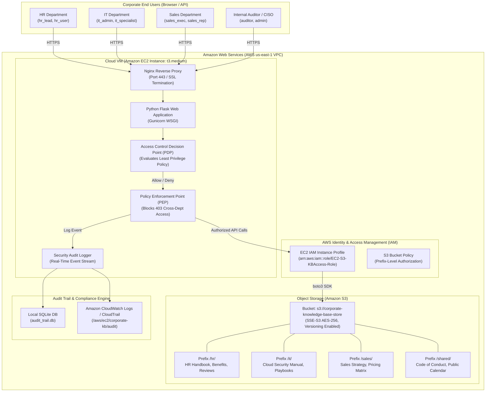

# Deliverable 1: Detailed Architecture Diagram
## Corporate Internal Knowledge Base (Cloud File-Sharing Application)

### 1. High-Level Architecture Overview
The system is built on a 3-tier enterprise cloud architecture designed for high availability, zero-trust security boundaries, and strict departmental data segregation:
- **Presentation & Web Tier:** Nginx reverse proxy terminating TLS, routing traffic to a Python WSGI/Gunicorn application server hosted on an **AWS EC2 Virtual Machine**.
- **Application & RBAC Engine Tier:** Enforces fine-grained department-level access control, session authentication, keyword search indexation, and real-time audit event dispatching.
- **Object Storage Tier:** **Amazon S3** (`s3://corporate-knowledge-base-store/`) configured with prefix-isolated folders (`/hr/`, `/it/`, `/sales/`, `/shared/`), Server-Side Encryption (SSE-S3 / AES-256), and bucket policies.
- **Audit & Monitoring Tier:** Dual-layer logging comprising an immutable local SQLite audit database and integration with **Amazon CloudWatch Logs / AWS CloudTrail** for forensic non-repudiation.

---

### 2. Mermaid Architecture Diagram

---

### 3. Component Details & Security Interactions

| Component | Cloud Resource | Security Role & Function |
| :--- | :--- | :--- |
| **Compute VM** | Amazon EC2 (`t3.medium`, Ubuntu 24.04 / Amazon Linux 2023) | Hosts web server, terminates TLS, enforces business logic, evaluates permissions. |
| **Reverse Proxy** | Nginx | Hides application server, enforces rate limiting, buffers requests, secures HTTP headers. |
| **IAM Instance Role** | `EC2-S3-KBAccess-Role` | Eliminates hardcoded AWS credentials on the VM; provides short-lived AWS STS tokens. |
| **Object Storage** | Amazon S3 Bucket | Stores departmental documents under dedicated prefixes. Enforces encryption at rest (AES-256). |
| **Access Control** | Flask RBAC + S3 Bucket Policy | Guarantees that HR cannot access IT or Sales data, preserving strict data confidentiality. |
| **Audit Trail** | SQLite + CloudWatch Logs | Captures all actions (Timestamp, User ID, Client IP, Target, Status) for forensic analysis. |
