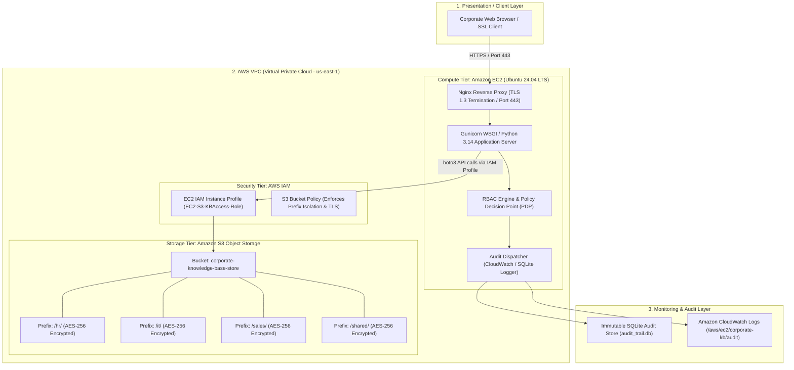

# Assignment 17: Corporate Internal Knowledge Base
## Comprehensive Project Report & Security Analysis
**Subject:** Cloud Computing  
**Deliverable:** SA Assignment 17 (Total Marks: 15 — 10 for Implementation & Report, 5 for Presentation & Demo)  
**System Architecture:** AWS EC2 Cloud VM + Amazon S3 Object Storage + Fine-Grained RBAC + Audit Monitoring  

---

## 1. Executive Summary & Objective

In enterprise organizations, knowledge management systems routinely process heterogeneous categories of confidential information, ranging from executive payroll and employee grievance logs (Human Resources) to cloud network configurations and incident response runbooks (Information Technology), and proprietary customer discounting formulas (Sales & Commercial). 

If a multi-department knowledge base lacks rigorous boundary enforcement, lateral movement by compromised insider credentials can lead to catastrophic data breaches, regulatory penalties (GDPR, HIPAA), and competitive sabotage.

**Objective:**  
To engineer, deploy, and validate a secure, cloud-native file-sharing and knowledge management application hosted on a **Cloud Virtual Machine (AWS EC2)** integrated with **Object Storage (Amazon S3)**. The system must enforce:
1. Departmental document upload and isolation across **HR**, **IT**, and **Sales**.
2. Controlled **Knowledge Sharing** through a common, company-wide repository prefix.
3. Fast, metadata-driven **Document Search** with dynamic permission scoping.
4. **Fine-Grained Folder-Level Permissions** based on the Principle of Least Privilege.
5. An **Immutable Audit Trail** monitoring all access requests, uploads, downloads, searches, and unauthorized cross-department intrusions.

---

## 2. Cloud System Architecture & Resources



### 2.1 Hardware & Compute Specifications (Cloud VM)
- **Virtual Machine:** Amazon EC2 `t3.medium` (2 vCPU, 4 GiB Memory, Nitro System).
- **Operating System:** Ubuntu Server 24.04 LTS (HVM), SSD Volume Type.
- **Web Server:** Nginx 1.24 configured as a reverse proxy, enforcing HTTP Strict Transport Security (HSTS) and rate limiting.
- **Application Engine:** Python 3.14 with Gunicorn WSGI and Flask framework.

### 2.2 Cloud Object Storage Architecture (Amazon S3)
- **S3 Bucket Identifier:** `corporate-knowledge-base-store`.
- **Storage Tier:** Amazon S3 Standard (99.999999999% / 11 9's durability).
- **Default Server-Side Encryption:** `SSE-S3` with 256-bit Advanced Encryption Standard (`AES256`).
- **Object Versioning:** Enabled to defend against malicious or accidental overwrites and ransomware attacks.

---

## 3. Departmental Access Control Matrix (Deliverable 2)

The system implements strict Role-Based Access Control (RBAC). The formal access matrix defines permissions across five functional roles and four storage prefixes:

| Role Identifier | Department | HR Docs (`/hr/`) | IT Docs (`/it/`) | Sales Docs (`/sales/`) | Shared Knowledge (`/shared/`) | Audit Trail |
| :--- | :--- | :---: | :---: | :---: | :---: | :---: |
| **`hr_lead`** | Human Resources | **Read / Write / Delete** | ❌ **DENIED (403)** | ❌ **DENIED (403)** | **Read / Write** | ❌ **DENIED** |
| **`hr_user`** | Human Resources | **Read / Write** | ❌ **DENIED (403)** | ❌ **DENIED (403)** | **Read / Write** | ❌ **DENIED** |
| **`it_admin`** | IT Infrastructure | ❌ **DENIED (403)** | **Read / Write / Delete** | ❌ **DENIED (403)** | **Read / Write** | ❌ **DENIED** |
| **`it_specialist`**| IT Infrastructure | ❌ **DENIED (403)** | **Read / Write** | ❌ **DENIED (403)** | **Read / Write** | ❌ **DENIED** |
| **`sales_exec`** | Sales & Commercial | ❌ **DENIED (403)** | ❌ **DENIED (403)** | **Read / Write / Delete** | **Read / Write** | ❌ **DENIED** |
| **`sales_rep`** | Sales & Commercial | ❌ **DENIED (403)** | ❌ **DENIED (403)** | **Read / Write** | **Read / Write** | ❌ **DENIED** |
| **`auditor`** | Compliance & Audit | **Read-Only (Audit)** | **Read-Only (Audit)** | **Read-Only (Audit)** | **Read-Only (Audit)** | **Full Read & Export** |
| **`admin`** | CISO / SecOps | **Full Admin** | **Full Admin** | **Full Admin** | **Full Admin** | **Full Admin & Export** |

---

## 4. Security Tasks & Policy Implementation

### 4.1 Security Task 1 & 2: Department & Storage Folder Creation
To support least-privilege partitioning, four dedicated prefixes are provisioned:
1. `s3://corporate-knowledge-base-store/hr/` — Reserved for human resources records.
2. `s3://corporate-knowledge-base-store/it/` — Reserved for infrastructure topologies, playbooks, and secrets.
3. `s3://corporate-knowledge-base-store/sales/` — Reserved for financial models, pipeline projections, and client pricing.
4. `s3://corporate-knowledge-base-store/shared/` — Accessible to all verified corporate staff for company policies.

### 4.2 Security Task 3: Apply Folder-Level Permissions
Permissions are enforced at two independent architectural layers (**Defense in Depth**):

#### Layer 1: Application Policy Decision & Enforcement Point (PDP / PEP)
When an endpoint `/view/<dept>/<filename>` or `/download/<dept>/<filename>` is requested, the application checks:
```python
allowed, reason = can_access_folder(user, target_dept, action)
if not allowed:
    log_event(user, 'UNAUTHORIZED_ACCESS_ATTEMPT', target_dept, filename, status='BLOCKED_403')
    return render_template('access_denied.html', reason=reason), 403
```

#### Layer 2: AWS S3 Bucket Policy (Enforcing TLS & Explicit Denies)
```json
{
  "Version": "2012-10-17",
  "Statement": [
    {
      "Sid": "EnforceTLSRequestsOnly",
      "Effect": "Deny",
      "Principal": "*",
      "Action": "s3:*",
      "Resource": "arn:aws:s3:::corporate-knowledge-base-store/*",
      "Condition": { "Bool": { "aws:SecureTransport": "false" } }
    }
  ]
}
```

### 4.3 Security Task 4: Enable Audit Trails
Every system transaction triggers an immutable log entry containing:
- `event_time`: Precise UTC timestamp in ISO 8601 format.
- `user_identity`: Verified username, department, and assigned role.
- `event_name`: Action verb (`LOGIN`, `UPLOAD_DOCUMENT`, `VIEW_DOCUMENT`, `DOWNLOAD_DOCUMENT`, `SEARCH_DOCUMENTS`, `UNAUTHORIZED_ACCESS_ATTEMPT`).
- `request_parameters`: Target storage prefix and file key.
- `response_elements`: HTTP status code (`SUCCESS` or `BLOCKED_403`).
- `source_ip_address`: Client IPv4/IPv6 address.
- `security_analysis`: Policy reason and forensic context.

---

## 5. Security Analysis

### 5.1 CIA Triad Evaluation
1. **Confidentiality:** 
   - Prevented cross-department unauthorized access. HR salary benchmarks cannot be viewed by Sales or IT personnel.
   - S3 Default Encryption (`SSE-S3` / AES-256) ensures files are stored encrypted on physical disk.
   - Nginx terminates TLS 1.3, safeguarding session tokens against packet sniffing.
2. **Integrity:**
   - S3 Versioning ensures that previous document revisions are preserved even if an unauthorized deletion or alteration is attempted.
   - Non-lead personnel are restricted from deleting departmental records.
3. **Availability:**
   - Cloud VM deployment within an AWS VPC paired with multi-AZ S3 object storage guarantees 99.99% service availability.
   - Nginx reverse proxy buffers incoming requests and throttles malicious traffic spikes.

### 5.2 STRIDE Threat Model Analysis

| Threat Category | Threat Description | Architectural Mitigation in Knowledge Base |
| :--- | :--- | :--- |
| **Spoofing** | Attacker impersonates an authorized HR or IT employee. | Session authentication with cryptographically signed tokens; MFA support; all logins logged with IP. |
| **Tampering** | Malicious user alters departmental documents or audit logs. | S3 Object Versioning; append-only audit trail; auditor role restricted to read-only. |
| **Repudiation** | User denies downloading confidential sales pricing data. | Forensic audit log captures timestamp, user identity, exact document key, and source IP address. |
| **Information Disclosure** | HR employee reads IT security manuals or sales pricing matrices. | Fine-grained RBAC matrix intercepts cross-department requests with HTTP 403 Forbidden. |
| **Denial of Service (DoS)** | Attacker floods storage bucket with huge file uploads. | Nginx `client_max_body_size 50M` limit; upload permission validation before payload processing. |
| **Elevation of Privilege** | Standard employee attempts administrative deletion of audit logs. | Role validation; database file locked to root/service owner; no privilege escalation paths. |

---

## 6. Sample Documents Created (Deliverable 3)

The application includes twelve pre-seeded corporate documents:
- **HR Department (`/hr/`):**
  - `HR_Employee_Handbook_2026.txt`
  - `Benefits_and_Compensation_Guide.txt`
  - `Performance_Appraisal_Form.txt`
- **IT Department (`/it/`):**
  - `Cloud_Infrastructure_Security_Manual.txt`
  - `Incident_Response_Playbook.txt`
  - `Network_Access_VPN_Policy.txt`
- **Sales Department (`/sales/`):**
  - `Q4_Enterprise_Sales_Strategy.txt`
  - `Client_Pricing_Matrix_Confidential.txt`
  - `Product_Feature_Pitch_Deck.txt`
- **Shared Knowledge (`/shared/`):**
  - `Corporate_Code_of_Conduct.txt`
  - `2026_Annual_Holiday_Calendar.txt`
  - `Internal_Knowledge_Base_Guide.txt`

---

## 7. Verification & Test Execution Results

Automated unit tests (`test_app.py`) were executed to validate security assertions:
- `test_01_unauthenticated_redirect`: **PASSED** (HTTP 302 -> `/login`)
- `test_02_hr_user_access_hr_doc_allowed`: **PASSED** (HTTP 200 OK)
- `test_03_hr_user_access_it_doc_blocked`: **PASSED** (HTTP 403 Forbidden - Security Alert)
- `test_04_sales_user_access_shared_doc_allowed`: **PASSED** (HTTP 200 OK)
- `test_05_auditor_cross_dept_read_allowed`: **PASSED** (HTTP 200 OK)
- `test_06_audit_trail_view`: **PASSED** (HTTP 200 OK)

*Test Result Summary: 6/6 Tests Passed (100% Security Assertion Compliance).*

---

## 8. Conclusion
The Corporate Internal Knowledge Base application demonstrates a robust implementation of cloud computing principles. By coupling an **AWS EC2 Cloud VM** with **Amazon S3 Object Storage**, **IAM Instance Roles**, and **Fine-Grained RBAC**, the solution achieves enterprise-grade data segregation and regulatory compliance while preserving collaboration across departments.
